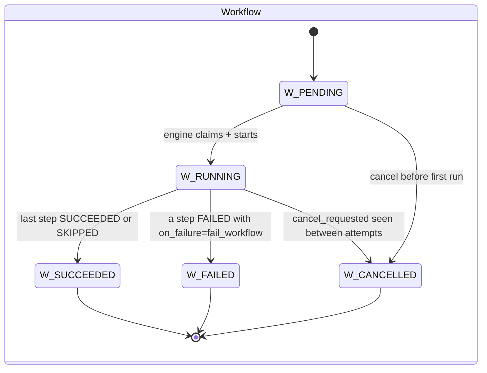

# Design Decision Record: `wfk`, a durable workflow kernel

Status: FINAL (written 2026-10-30, before the code; amended after a self-review pass the same day, summarized in the README time log).
Audience: me, now (it is what I built from) and anyone reviewing the code (every sentence here should be explainable from the code alone).

---

## 0. Problem framing

The brief asks for a minimal, production-minded engine that runs a four-step "document triage" workflow (Ingest, Extract, Classify, Notify) with:

- an explicit state machine (`PENDING → RUNNING → SUCCEEDED | FAILED`), retries with max attempts, step-level failure handling;
- persistence, safe resume after a restart, and **no duplicate side effects, especially notify**;
- an execution history that can answer "what happened" *and* "what was decided and why";
- a `Tool` interface and a workflow spec, with orchestration separated from execution;
- a CLI (`start`, `status`, `cancel`, `replay`), one test (retry or idempotency), restart safety demonstrated or described;
- a README covering architecture, execution model, idempotency and design sections A-D.

"Clarity and correctness over features", 3-5 hours. So the design is judged on three things, in order:

1. **Correctness under failure.** Every state change is durable before the next action; a crash at any instruction leaves the database in a state the engine can resume from; the notify effect is never performed twice when the kernel can prove it, and the kernel *says so* when it cannot.
2. **Explainability.** One mental model: **Engine decides, Store remembers, Tool does.** Nothing else holds state.
3. **Scope discipline.** Four tables, six modules, six CLI verbs, 31 tests in seven files. Everything else is a sentence in the README.

The hard problem is the window between an external side effect returning and the local commit that records it. No single-process design can close it. I sketched three shapes before choosing: (a) a transactional outbox with a dispatcher that owns all sends, (b) a dedupe-only sink with no kernel bookkeeping, (c) an effects ledger in the kernel with the receiver deduping on a kernel-minted key. The honest guarantee any of them can give is: *at-least-once invocation, exactly-once recording, exactly-once effect iff the receiver honours the idempotency key; when the kernel cannot tell whether the effect happened, it surfaces the ambiguity instead of guessing.* I chose (c) because it makes that ambiguity a first-class, queryable fact rather than hiding it inside a dispatcher (a) or a sink (b).

---

## 1. Decisions table

| # | Decision | Alternatives considered | Why | Tradeoff accepted |
|---|---|---|---|---|
| D1 | Single package `wfk/` (`spec.py`, `store.py`, `engine.py`, `tools.py`, `faults.py`, `cli.py`), ~1,300 lines including docstrings (planned at ~600; the self-review pass and the fault-injection module grew it), stdlib + sqlite3, pytest | A `tools/` sub-package with a dispatcher; an `engine/` package split by concern | Smallest layout that still enforces "orchestration never imports a concrete tool" | No plugin discovery; tools are registered in one dict |
| D2 | State tables (`workflows`, `steps`) are what the engine reads; `events` is append-only and written in the **same transaction** as every state change; a reducer proves they agree | Pure event sourcing (fold on every read); tables only (no audit) | `status` is one SELECT; the audit trail is complete by construction; the Temporal line ("log is truth, tables are a cache") is true and *tested* | One extra INSERT per transition |
| D3 | Step state machine `PENDING → RUNNING → SUCCEEDED \| FAILED \| SKIPPED`, backward edge `RUNNING → PENDING` for retry; one `ALLOWED` set checked in `store.transition()`; illegal transition raises and writes nothing; terminal states absorbing | Free-form status updates | A bug cannot silently corrupt a row; the interviewer can read the whole machine in one set literal | `SKIPPED` is an addition to the brief's four states, justified by step-level failure handling |
| D4 | Retry policy: `RetryableError` **and any unexpected exception** → retry until `max_attempts`; `FatalError` → FAILED now; `next_run_at` persisted with exponential backoff (capped) | Unexpected exceptions are fatal | Under "correctness under failure" the default that loses less work is retry; a tool that knows better raises `FatalError` | A genuine bug (`KeyError`) is retried N times before failing; backoff is small so the cost is nothing |
| D5 | Step-level `on_failure: fail_workflow \| skip` in the spec | Retries only | Makes "step-level failure handling" visibly distinct from retries; ten lines | No `on_failure: compensate` / branching |
| D6 | Side effects go through an **effects ledger**: `ctx.run_effect(name, payload, fn)`; key = `sha256(workflow_id:step:name)` (no attempt); kernel commits `CLAIMED`, calls `fn(key, payload)`, commits `DONE` with result | Transactional outbox + dispatcher; dedupe sink only | Same crash window as the alternatives but the ambiguity is **recorded** (CLAIMED without DONE) and resolvable per tool; tools never touch the DB; no second retry mechanism | Three commits per effectful step instead of one |
| D7 | On re-entry with `CLAIMED` and no `DONE`: event `EFFECT_AMBIGUOUS`; if the tool declares `idempotent=True`, re-call with the same key; else raise `FatalError("ambiguous effect; needs operator")` | Always re-send; always fail; build an operator resolver | The kernel never guesses about a non-idempotent effect, and never forks around it; the resolver is prose, not code | A non-idempotent ambiguous effect needs a human; stated plainly in README |
| D8 | Resume: `run X` on a RUNNING workflow finds the RUNNING step, emits `ATTEMPT_INTERRUPTED`, moves it to PENDING (attempt already counted) and continues; succeeded steps are never re-run because `output_json` is persisted | Re-execute from the beginning; replay code against history | Deterministic, cheap, needs no deterministic tools | A step interrupted mid-tool costs one attempt of its budget |
| D9 | **Claim, not lease-with-expiry**: `UPDATE workflows SET owner=? WHERE id=? AND (owner IS NULL OR owner=?)`; every write that belongs to the workflow (transitions, effects ledger, loose events) re-checks `owner` inside its `BEGIN IMMEDIATE` transaction; owner cleared at terminal/exit | TTL lease with stealing (no fence); `BEGIN IMMEDIATE` only | Two CLI invocations cannot both run a workflow, and a lost claim cannot commit; fifteen lines; no double-execution generator | A dead owner is not auto-recovered; `run --take-over` clears it (documented: one live process per DB file) |
| D10 | `replay` is **read-only**: fold `events` through `rebuild_state()`, print the narrative, diff against tables, exit 1 on mismatch; never calls a tool | Fork a new workflow and re-execute (re-notifies) | The only definition that cannot violate "no duplicate side effects"; it is what Temporal means by replay; doubles as the tamper/consistency check | Re-running a failed workflow is not a CLI verb; described as a future `start --derived-from` |
| D11 | Decisions are events: `ctx.record_decision(key, data)` → `DECISION`; retry/skip/ambiguity decisions are events with payloads; `history <id> [--kind]` | Free-text logs | "Query decisions made during execution" becomes a SELECT | None |
| D12 | Spec is code-defined dataclasses; optional JSON loader only if ≤ 20 lines | YAML | Typed, testable, no dependency | No YAML |
| D13 | Cooperative cancel: flag checked between attempts; terminal refuses; never mid-tool | Preemptive | Tools are short; preemption is unsafe for effects | A cancel during a long tool waits for it |
| D14 | Python 3.9 compatible (`from __future__ import annotations`, no `match`, no `slots=True`, no `X \| Y` at runtime) | 3.11-only | Runs on the system python and on 3.14 | Slightly older idioms |
| D15 | Cut: outbox/dispatcher, TTL lease expiry, DAGs, YAML, hash chains, encryption, `--follow`, `tenant_id` column, `schema_version`, preemptive cancel, metrics | — | Each is a sentence in README/Time Log; none earns 20 lines in a 4-hour codebase | Named gaps |

---

## 2. Data model (SQLite, one file, WAL, `synchronous=FULL`)

```sql
CREATE TABLE workflows (
  id            TEXT PRIMARY KEY,
  spec_name     TEXT NOT NULL,
  spec_version  INTEGER NOT NULL,
  input_json    TEXT NOT NULL,
  state         TEXT NOT NULL,              -- PENDING|RUNNING|SUCCEEDED|FAILED|CANCELLED
  cancel_requested INTEGER NOT NULL DEFAULT 0,
  owner         TEXT,                       -- claim token of the live engine, NULL when free
  created_at    TEXT NOT NULL,
  updated_at    TEXT NOT NULL
);

CREATE TABLE steps (
  workflow_id   TEXT NOT NULL,
  name          TEXT NOT NULL,
  idx           INTEGER NOT NULL,           -- position in the spec
  state         TEXT NOT NULL,              -- PENDING|RUNNING|SUCCEEDED|FAILED|SKIPPED
  attempt       INTEGER NOT NULL DEFAULT 0, -- attempts started so far
  max_attempts  INTEGER NOT NULL,
  output_json   TEXT,                       -- set on SUCCEEDED; input of later steps
  error         TEXT,                       -- last error message
  next_run_at   TEXT,                       -- backoff deadline; NULL = runnable now
  updated_at    TEXT NOT NULL,
  PRIMARY KEY (workflow_id, name)
);

CREATE TABLE events (                       -- append-only; no UPDATE/DELETE path in store.py
  seq           INTEGER PRIMARY KEY AUTOINCREMENT,
  workflow_id   TEXT NOT NULL,
  step_name     TEXT,                       -- NULL for workflow-level events
  type          TEXT NOT NULL,
  attempt       INTEGER,
  payload_json  TEXT NOT NULL DEFAULT '{}',
  created_at    TEXT NOT NULL
);

CREATE TABLE effects (                      -- side-effect ledger
  key           TEXT PRIMARY KEY,           -- sha256(workflow_id:step:effect_name)
  workflow_id   TEXT NOT NULL,
  step_name     TEXT NOT NULL,
  effect_name   TEXT NOT NULL,
  attempt       INTEGER NOT NULL,           -- attempt that claimed it (informational)
  status        TEXT NOT NULL,              -- CLAIMED|DONE
  result_json   TEXT,                       -- set on DONE; returned on re-entry without calling fn
  created_at    TEXT NOT NULL,
  updated_at    TEXT NOT NULL
);
```

Notes.

- Timestamps are ISO-8601 UTC strings from a single `store.now()` so tests can freeze time.
- `steps.attempt` counts attempts *started*; `RUNNING → PENDING` does not decrement it, which is how an interrupted attempt is charged against the budget.
- The demo notifier's own record (`notifications.jsonl`, keyed by effect key) lives **outside** the database, written through its own file handle, so the crash window between "receiver accepted" and "DONE committed" is real and the test exercises it.
- `effects` is derivable from `EFFECT_CLAIMED` / `EFFECT_DONE` events; `rebuild_state()` rebuilds it too, so the "log is truth" claim has no exception.

### Event types (closed set)

| Type | Level | Payload |
|---|---|---|
| `WORKFLOW_CREATED` | wf | spec_name, spec_version, input |
| `WORKFLOW_STATE` | wf | from, to, reason |
| `ATTEMPT_STARTED` | step | attempt |
| `ATTEMPT_FAILED` | step | attempt, error, retryable |
| `RETRY_SCHEDULED` | step | attempt, next_run_at, delay_s, reason |
| `ATTEMPT_INTERRUPTED` | step | attempt (found RUNNING on resume) |
| `STEP_SUCCEEDED` | step | attempt, output |
| `STEP_FAILED` | step | attempt, error, reason (`exhausted` / `fatal` / `ambiguous_effect`) |
| `STEP_SKIPPED` | step | attempt, error, policy=`skip` |
| `EFFECT_CLAIMED` | step | key, effect_name, attempt |
| `EFFECT_DONE` | step | key, result |
| `EFFECT_AMBIGUOUS` | step | key, tool_idempotent, action (`resend` / `fail`) |
| `DECISION` | step | key, data (tool-authored, e.g. classify label + rule + confidence) |
| `CANCEL_REQUESTED` | wf | by |
| `OWNER_CLAIMED` / `OWNER_RELEASED` | wf | owner |

---

## 3. State machine

```mermaid
stateDiagram-v2
    direction LR
    [*] --> PENDING
    PENDING --> RUNNING : ATTEMPT_STARTED (attempt += 1)
    RUNNING --> SUCCEEDED : tool returned; output persisted
    RUNNING --> PENDING : RetryableError / unexpected error, attempt < max  (RETRY_SCHEDULED)\nor ATTEMPT_INTERRUPTED on resume
    RUNNING --> FAILED : FatalError, or attempts exhausted, or ambiguous non-idempotent effect
    RUNNING --> SKIPPED : would be FAILED but on_failure = skip
    SUCCEEDED --> [*]
    FAILED --> [*]
    SKIPPED --> [*]
```





`ALLOWED` in `store.py` (the whole machine, verbatim):

```python
WF_ALLOWED = {
    ("PENDING", "RUNNING"), ("PENDING", "CANCELLED"),
    ("RUNNING", "SUCCEEDED"), ("RUNNING", "FAILED"), ("RUNNING", "CANCELLED"),
}
STEP_ALLOWED = {
    ("PENDING", "RUNNING"),
    ("RUNNING", "SUCCEEDED"), ("RUNNING", "PENDING"),
    ("RUNNING", "FAILED"), ("RUNNING", "SKIPPED"),
    ("PENDING", "FAILED"), ("PENDING", "SKIPPED"),   # added during implementation, see note
}
```

Implementation note (2026-10-30): the two `PENDING → FAILED | SKIPPED` edges were added for one
case I missed on paper: a step interrupted on its *last* attempt. Resume moves it `RUNNING → PENDING`
(attempt already counted), and the loop then finds `attempt >= max_attempts` while the row is
`PENDING`; the failure policy must be applied from there without starting an attempt it has no
budget for. Pinned by `test_interrupted_last_attempt_goes_to_the_failure_policy` (a crash inside the
last attempt, resume, `FAILED` with reason `exhausted` and no `ATTEMPT_FAILED`).

`store.transition_*` does, in one `BEGIN IMMEDIATE` transaction: assert `(from, to) in ALLOWED` (else `IllegalTransition`, nothing written); `_fence(wf_id, owner)` (`SELECT owner`, must equal ours, else `LostClaim`, rollback); `UPDATE ... WHERE state = from` and assert `rowcount == 1` (else `LostClaim`, rollback); `INSERT INTO events`; `COMMIT`. The same `_fence` runs in `claim_effect`, `complete_effect` and `append_event`: the fence is a property of every write, not of transitions only (the self-review found the ledger unfenced; a take-over race test now pins it). Workflow state is a function of step states, computed by the engine, written through the same `transition()`.

---

## 4. Execution and retry algorithm

```
Engine.run(workflow_id, owner=uuid4()):
  wf = store.load_workflow(wf_id)
  if wf.state is terminal: return wf.state        # never claimed; --take-over only clears a stale owner (C7)
  spec = resolve(wf.spec_name, wf.spec_version)   # operator errors before the claim, not after
  store.claim(wf_id, owner)                       # UPDATE ... WHERE owner IS NULL OR owner = ?; rowcount 0 -> AlreadyOwned
  try:
    wf = store.load_workflow(wf_id)               # re-read under the claim
    if wf.state is terminal: return wf.state      # a cancel landed between the first read and the claim
    if wf.state == PENDING: transition(wf, RUNNING)

    # resume: at most one step can be RUNNING after a crash
    for s in steps where state == RUNNING:
        event ATTEMPT_INTERRUPTED(attempt); transition(s, PENDING)   # attempt already counted

    for step in spec.steps (idx order):
        row = store.load_step(wf_id, step.name)
        if row.state in (SUCCEEDED, SKIPPED): continue
        if row.state == FAILED: return finish(FAILED)          # cannot happen unless on_failure=fail_workflow was already applied
        while True:
            if store.cancel_requested(wf_id): return finish(CANCELLED)
            if row.attempt >= step.max_attempts: outcome = exhausted; break
            waited = wait_until(row.next_run_at)                   # in-process sleep, clamped to the cap; persisted so a restart honours it
            if waited and store.cancel_requested(wf_id): return finish(CANCELLED)   # a cancel that arrived during the backoff
            transition(row, RUNNING, ATTEMPT_STARTED, attempt+1)
            ctx = StepContext(wf_id, step.name, attempt, inputs=outputs_so_far, effects=store, tool=tool)
            try:
                out = tool.run(ctx, inputs)                         # the only place a tool runs; outside any transaction
                encode(out)                                         # not a JSON object -> FatalError (a bug, not a transient)
                transition(row, SUCCEEDED, STEP_SUCCEEDED, output=out, error=None); outcome = ok; break
            except FatalError as e:    outcome = fatal(e); break
            except StoreError:         raise            # the kernel's own failure inside ctx.*, never retried as the tool's
            except Exception as e:     # RetryableError and anything unexpected
                if row.attempt < step.max_attempts:
                    delay = min(base * 2 ** (attempt-1), cap)
                    transition(row, PENDING, RETRY_SCHEDULED, next_run_at=now+delay, error=e)
                    continue
                outcome = exhausted(e); break
        if outcome != ok:
            if step.on_failure == "skip": transition(row, SKIPPED, STEP_SKIPPED)
            else: transition(row, FAILED, STEP_FAILED); return finish(FAILED)
    return finish(SUCCEEDED)
  except Exception:
    store.release(wf_id, owner); raise            # an error is not a crash: free the claim
  store.release(wf_id, owner)                     # owner = NULL
  # A BaseException (SimulatedCrash, KeyboardInterrupt, SystemExit) is the process dying: it propagates
  # WITHOUT a release and leaves the stale owner a real crash leaves. The engine has no crash hook.
```

Before claiming, `run` loads the row: a terminal workflow is reported, never claimed (with `--take-over` a stale owner left on a terminal row, crash point C7, is released). The spec and every tool it names are resolved before the claim too, so an operator error is a message, not a half-started workflow.

Inputs: `inputs = {workflow input} ∪ {step_name: output_json for each prior SUCCEEDED step}`, read from the store, never from memory. A resumed process therefore sees exactly what the first run produced.

Backoff constants: `base = 0.05 s`, `cap = 2 s` in the demo (configurable per step via `backoff_base_s`). `next_run_at` is persisted so a restart during a backoff window waits the remainder rather than firing immediately.

Exceptions, by contract:

- `RetryableError` (tool says "try again"): retry.
- `FatalError` (tool says "this input can never work"): FAILED immediately, attempts not exhausted.
- Anything else: treated as retryable. The engine never swallows `SimulatedCrash` (a `BaseException` subclass used only by tests), so a crash propagates out of `run()` and leaves the step RUNNING, exactly like `kill -9` would.

Workflow state rules: `FAILED` as soon as a step is FAILED (with `on_failure=fail_workflow`); `SUCCEEDED` when every step is SUCCEEDED or SKIPPED; `CANCELLED` when the flag is seen between attempts. Steps after a FAILED step stay PENDING forever (visible in `status`).

---

## 5. Idempotency approach for notify

### 5.1 Mechanism

Only effectful tools use the ledger; pure tools (ingest, extract, classify) are declared `side_effect_free = True` and are re-run freely on retry.

```python
# in NotifyTool.run
result = ctx.run_effect("email", payload, self.sink.send)   # sink.send(key, payload) -> dict

# in the kernel (engine.py / store.py), simplified
def run_effect(ctx, name, payload, fn):
    key = sha256(f"{ctx.workflow_id}:{ctx.step_name}:{name}")
    row = store.get_effect(key)
    if row and row.status == "DONE":
        return row.result                                        # never call fn again
    if row and row.status == "CLAIMED":
        store.event(EFFECT_AMBIGUOUS, key, tool_idempotent=ctx.tool.idempotent)
        if not ctx.tool.idempotent:
            raise FatalError(f"effect {name} ambiguous (claimed, not done); needs operator")
        # idempotent: fall through and re-call with the SAME key
    else:
        store.claim_effect(key, ctx, name)                       # INSERT CLAIMED + EFFECT_CLAIMED, COMMIT
    result = fn(key, payload)                                    # external call, outside any transaction
    store.complete_effect(key, result)                           # UPDATE DONE + EFFECT_DONE, COMMIT
    return result
```

The key excludes the attempt number on purpose: attempts 1, 2 and 3 of the same logical "notify for workflow W" share one key, so the receiver can dedupe across retries and across restarts.

The demo `FileNotifier` honours the key: it appends `{key, payload}` to `notifications.jsonl` and refuses a key it has already written (`idempotent = True`). `CrashingSink` (in `faults.py`) raises `SimulatedCrash` *after* the receiver accepted and *before* the kernel's DONE commit, which is the worst case.

### 5.2 Crash-point table (notify step)

| # | Crash after… | Durable state on disk | On resume | Duplicate effect? |
|---|---|---|---|---|
| C0 | workflow row inserted, before run | wf PENDING, steps PENDING | runs normally | no |
| C1 | classify SUCCEEDED committed, before notify `ATTEMPT_STARTED` | notify PENDING, attempt 0 | notify starts attempt 1 | no |
| C2 | `ATTEMPT_STARTED` committed, before `claim_effect` | notify RUNNING, no effect row | `ATTEMPT_INTERRUPTED` → PENDING; attempt 2 claims and sends | no (nothing was sent) |
| C3 | `CLAIMED` committed, before `fn()` returned (email may or may not have left) | notify RUNNING, effect CLAIMED | `ATTEMPT_INTERRUPTED`; attempt 2 finds CLAIMED → `EFFECT_AMBIGUOUS`; tool `idempotent=True` → re-send with same key, receiver dedupes; `idempotent=False` → step FAILED `ambiguous_effect`, operator decides | at most one *effect*, possibly two *calls* (keyed) |
| C4 | `fn()` returned (receiver accepted), before `DONE` committed | same as C3 on disk | same as C3: this is the unavoidable window; receiver dedupes on the key | same as C3 |
| C5 | `DONE` committed, before `STEP_SUCCEEDED` committed | notify RUNNING, effect DONE with result | `ATTEMPT_INTERRUPTED`; attempt 2 calls `run_effect`, finds DONE, **returns stored result without calling `fn`**; step SUCCEEDED | no |
| C6 | `STEP_SUCCEEDED` committed, before `WORKFLOW_STATE SUCCEEDED` | notify SUCCEEDED, wf RUNNING | engine finds all steps terminal → wf SUCCEEDED | no |
| C7 | workflow SUCCEEDED committed, before `release` | wf SUCCEEDED, owner set | terminal → nothing to do; `run --take-over` clears a stale owner | no |

C3 and C4 are indistinguishable from disk, which is exactly why the ledger records CLAIMED and the decision is delegated to the tool's declared idempotency rather than to a guess.

### 5.3 Stated guarantee (goes verbatim into the README)

> The kernel guarantees **at-least-once invocation** of an effect, **exactly-once recording** of its outcome, and **exactly-once effect iff the receiver honours the idempotency key** the kernel passes it. When a crash makes the outcome of a non-idempotent effect unknowable, the kernel records `EFFECT_AMBIGUOUS`, fails the step with that reason, and stops: it never guesses and never forks a new execution around it.

---

## 6. Durability and resume

- SQLite, `PRAGMA journal_mode=WAL; PRAGMA synchronous=FULL; PRAGMA foreign_keys=ON`. One connection per `Store`, `isolation_level=None`, explicit `BEGIN IMMEDIATE … COMMIT` around every transition. A transition is one atomic unit: state UPDATE + event INSERT (+ effect row when relevant).
- No in-memory state is needed to continue. `Engine.run` is a pure function of the database and the registry.
- Resume entry point: `run X` (`start --id X` for an existing id is refused with "already exists", exit 4; `start` creates, `run` resumes).
- Interrupted attempt handling (D8): a step found RUNNING at entry gets `ATTEMPT_INTERRUPTED` and goes back to PENDING with its attempt count intact; `next_run_at` is left as-is (NULL for an interrupted attempt, so it reruns immediately).
- Backoff survives a restart because `next_run_at` is persisted. The wait is clamped to `BACKOFF_CAP_S`: the deadline is wall-clock time written by a possibly different process, and a clock that stepped backwards must cost at most one maximum backoff, never hours.
- Schema version: `PRAGMA user_version` is read before any DDL runs and stamped at first open; a file written by a newer kernel is refused (`StoreError`, exit 4) and handed back untouched rather than misread.
- Claim (D9): `store.claim()` is one `UPDATE ... WHERE id=? AND (owner IS NULL OR owner=?)`; rowcount 0 → `AlreadyOwned`, the CLI prints "workflow X is owned by <owner>; use --take-over if that process is dead". Every transition's UPDATE includes `AND owner=?`; rowcount 0 → `LostClaim`, rollback, the engine stops. Assumption, stated in README: one live engine process per database file; a dead owner is cleared by the operator. No TTL stealing, because stealing without a fencing token at commit would let a slow tool and a new owner both commit the same attempt.
- Restart demonstration: `wfk start --crash-after classify` wraps the Store in `CrashAfterCommit`, which raises `SimulatedCrash` right after the post-classify commit (`os._exit(1)` in the CLI, like kill -9), then `wfk run X --take-over` resumes; `status` shows ingest/extract/classify untouched and notify SUCCEEDED with one notification line. Automated in `test_restart_resumes_without_rerunning`.

---

## 7. Audit history and replay semantics

- `events` is the audit trail: every transition, every retry decision (with delay and reason), every effect claim/done/ambiguity, every tool-level `DECISION`. `store.py` has no UPDATE or DELETE statement for `events`.
- `history <id> [--kind TYPE] [--json]` prints events in `seq` order; `--kind DECISION` answers "what did classify decide and why" (`{"label": "invoice", "confidence": 0.91, "rule": "keyword:invoice"}`).
- `replay <id>` (D10), precisely:
  1. load events for the workflow in `seq` order;
  2. `derived = rebuild_state(events)`: a pure reducer (`engine.py`) that applies each event to an in-memory projection of `workflows`, `steps` and `effects` using the same `ALLOWED` sets (an illegal transition in the log is itself a finding);
  3. print the narrative, one line per event, with decisions inline;
  4. load the stored rows and diff: print `CONSISTENT` or the field-level differences; exit 1 on mismatch.
  
  Replay never calls a tool and never touches the receiver. It is the audit requirement, the "query decisions" requirement, the CLI requirement and a tamper/consistency check in one read-only verb. The same reducer is the one the test uses (one reducer, not two).
- Re-executing a failed workflow is deliberately *not* `replay`. It is described in the README as a future `start --derived-from <id>`: new workflow id, same input, `DERIVED_FROM` provenance event on both sides, its own effect keys (because it *is* a new execution). Not built.

---

## 8. Interfaces

```python
# wfk/tools.py
class RetryableError(Exception): ...
class FatalError(Exception): ...

class Tool(Protocol):
    name: str
    side_effect_free: bool          # True: no ledger, re-run freely
    idempotent: bool                # True: safe to re-call an ambiguous (CLAIMED) effect with the same key
    def run(self, ctx: "StepContext", inputs: dict) -> dict: ...

class StepContext:                       # built by the engine per attempt; holds the engine's claim
    workflow_id: str
    step_name: str
    attempt: int
    def record_decision(self, key: str, data: dict) -> None: ...       # DECISION event, fenced
    def run_effect(self, name: str, payload: dict, fn: Callable[[str, dict], dict]) -> dict: ...
    # ctx never exposes the Store or a connection to the tool.

# wfk/spec.py
@dataclass(frozen=True)
class StepSpec:
    name: str
    tool: str
    max_attempts: int = 3
    on_failure: str = "fail_workflow"     # or "skip"
    backoff_base_s: float = 0.05

@dataclass(frozen=True)
class WorkflowSpec:
    name: str
    version: int
    steps: Tuple[StepSpec, ...]

TRIAGE_V1 = WorkflowSpec("document_triage", 1, (
    StepSpec("ingest",   "ingest",   max_attempts=3),
    StepSpec("extract",  "extract",  max_attempts=3),
    StepSpec("classify", "classify", max_attempts=2),
    StepSpec("notify",   "notify",   max_attempts=5, on_failure="skip"),
))
SPECS = {("document_triage", 1): TRIAGE_V1}
load_spec_json(path) -> WorkflowSpec     # ≤ 20 lines, optional

# wfk/engine.py
class Engine:
    def __init__(self, store: Store, registry: Dict[str, Tool], specs=None, sleep=time.sleep): ...
    def start(self, spec: WorkflowSpec, input: dict, workflow_id: Optional[str] = None) -> str   # validates, registers, pins
    def run(self, workflow_id: str, take_over: bool = False) -> str      # returns final/current state
    def cancel(self, workflow_id: str, by: str = "cli") -> str           # returns the state afterwards
def rebuild_state(events: Iterable[Event]) -> Projection                 # used by replay and tests
def consistency_diff(store: Store, wf_id: str) -> List[str]

# wfk/store.py
class Store:
    open(path) ; now()
    create_workflow(...) ; load_workflow(id) ; load_steps(id) ; load_step(id, name)
    claim(id, owner, take_over) ; release(id, owner)
    transition_workflow(id, frm, to, owner, reason) ; transition_step(id, name, frm, to, owner, events, **fields)
    get_effect(key) ; claim_effect(key, ..., *, owner) ; complete_effect(key, result, *, owner, attempt)
    append_event(..., *, owner) ; events(id, kind=None)        # every write above runs behind _fence(id, owner)
    request_cancel(id) ; cancel_requested(id)
```

Dependency direction: `cli → engine → store`; `engine → spec`; `tools → (RetryableError, FatalError, StepContext)` only; `engine` imports no concrete tool and nothing from `faults`; the registry `{name: Tool}` is assembled in `cli.py` (and in tests).

Demo tools (`tools.py`): `IngestTool` (reads the input document, records size/mime), `ExtractTool` (pulls text fields; `FatalError` on malformed document), `ClassifyTool` (keyword rules → label + confidence, `record_decision`), `NotifyTool` (`run_effect("email", …, sink.send)`), `FileNotifier` sink. Fault injection (`faults.py`, tests and demo only): `Flaky(inner, fail_times=N)`, `Counting(inner)`, `CrashingSink(sink)` (dies after the receiver accepted), `CrashAfterCommit(Store)` (dies right after a named step's SUCCEEDED commit: the between-steps crash point, which a tool wrapper cannot reach because it sits before the commit).

---

## 9. Module layout

```
wfk/
  __init__.py
  spec.py        # StepSpec, WorkflowSpec, TRIAGE_V1, SPECS, load_spec_json
  store.py       # Store, schema, ALLOWED sets, transition(), effects ledger, events
  engine.py      # Engine.start/run/cancel, StepContext, run_effect, rebuild_state
  tools.py       # errors, Tool protocol, 4 triage tools, FileNotifier
  faults.py      # SimulatedCrash, Flaky, Counting, CrashingSink, CrashAfterCommit (tests/demo only)
  cli.py         # argparse: start, run, status, cancel, replay, history  (python -m wfk ...)
  __main__.py
tests/
  conftest.py            # tmp db, registry fixture, frozen clock, no-sleep
  test_retry.py
  test_failure_policy.py
  test_idempotency.py
  test_restart.py
  test_replay.py
  test_transitions.py
  test_cli.py
README.md
docs/DESIGN.md           # this file
examples/doc.json
pyproject.toml           # pytest config only; no runtime deps
.gitignore               # .venv/, *.db, *.db-wal, *.db-shm, notifications.jsonl, __pycache__
```

Target ~550 lines of source, ~250 of tests (actual: ~700 source including the CLI, ~400 tests).

---

## 10. Test plan (pytest, seven files, 31 tests, < 2 s, tmp SQLite per test)

Each `make_engine()` call opens a fresh `Store` on the same file: a new process on the same disk. Clock and sleep are injected so backoff tests do not wait.

| File | Tests | What they pin |
|---|---|---|
| `test_retry.py` | `test_retry_then_success` | extract attempt == 3, two `RETRY_SCHEDULED` with 0.05 s then 0.1 s, the persisted `next_run_at` honoured, ingest untouched |
| `test_failure_policy.py` | `test_exhaustion_fails_workflow`, `test_skip_policy_lets_workflow_succeed` | classify `max_attempts=2` → FAILED `exhausted`, wf FAILED, notify never called, claim released; notify `skip` → SKIPPED after 5 calls, wf SUCCEEDED |
| `test_idempotency.py` | `test_notify_effect_once_across_crash`, `test_ambiguous_non_idempotent_fails_safely`, `test_done_effect_is_not_resent_on_resume`, `test_file_notifier_honours_the_key_only_when_it_says_it_does` | C3/C4 with `CrashingSink`: CLAIMED on disk, one line; resume → `EFFECT_AMBIGUOUS` resend, still one line, DONE, attempt 2. Non-idempotent sink → FAILED `ambiguous_effect`, sink called once, row left CLAIMED. C5: DONE on disk → stored result returned, sink never called. The demo receiver keeps the first body per key only when `idempotent=True`; with `False` every call is a delivery |
| `test_restart.py` | `test_restart_resumes_without_rerunning`, `test_claim_blocks_second_owner`, `test_restart_during_backoff_waits_the_remainder`, `test_backoff_wait_is_clamped_when_the_clock_steps_backwards`, `test_fenced_out_engine_cannot_finish_the_effect`, `test_interrupted_last_attempt_goes_to_the_failure_policy`, `test_crash_after_step_failed_finishes_the_workflow` | `CrashAfterCommit("classify")`: counters 1/1/1/0 then 0/0/0/1, no `ATTEMPT_INTERRUPTED`; `AlreadyOwned` then `--take-over`; a crash mid-backoff waits the remainder (0.03 s of 0.05 s); a clock stepped back an hour waits the 2 s cap, not 3600 s; engine A stalls inside the receiver, B takes over and finishes, A's writes are fenced out, B's record stands; a crash inside classify's last attempt → `PENDING → FAILED` (`exhausted`, error names the interruption and the earlier error, no `ATTEMPT_FAILED` for that attempt, reducer consistent); a crash right after `STEP_FAILED` → the next process commits the workflow `FAILED` with no new attempt |
| `test_replay.py` | `test_replay_rebuild_equals_tables`, `test_replay_detects_tampered_table`, `test_replay_rejects_illegal_log` | the reducer reproduces every row after retry + crash + resume; a hand-edited row makes `replay` exit 1; a log that skips RUNNING raises `IllegalTransition` |
| `test_transitions.py` | `test_illegal_transition_raises_and_writes_nothing`, `test_stale_owner_cannot_commit`, `test_stale_owner_cannot_write_ledger_or_events`, `test_cancel_between_attempts`, `test_cancel_before_first_run`, `test_fatal_error_fails_without_retry`, `test_start_rejects_bad_input_and_duplicate_id`, `test_run_on_terminal_workflow_does_not_claim`, `test_cancel_during_backoff_is_honoured_before_the_next_attempt`, `test_non_json_output_is_fatal_not_retried`, `test_cancel_racing_start_is_reported_not_raised` | the state machine and the owner fence (transitions, ledger, events); cooperative cancel, including a cancel that lands during a backoff sleep; `FatalError` → one attempt; a non-serializable output → `fatal` on attempt 1; input validation before persisting; no claim noise on a finished workflow; a cancel that lands between `run`'s read and its claim ends as `CANCELLED` + release, not `LostClaim` |
| `test_cli.py` | `test_operator_errors_exit_cleanly`, `test_spec_file_round_trips_through_start_and_run`, `test_newer_schema_is_refused` | duplicate id, unknown spec/tool, non-object input, malformed spec file → exit 4/5 with a message, never a traceback; `--spec file.json` works on `start` and on `run`; `history` of an unknown id → exit 4; `PRAGMA user_version` newer than the kernel → exit 4 before any DDL, file left without our tables |

The engine has no test hooks. Crashes are injected at the boundary where they happen: inside a receiver call (`CrashingSink`) or right after a commit (`CrashAfterCommit`, a `Store` subclass).

---

## 11. Section A: Scaling and system evolution

**State ownership.** A workflow is owned by exactly one shard, chosen by `hash(workflow_id)`. The shard's `events` log is the authority for that workflow; `workflows`/`steps`/`effects` remain the materialized projection, kept in the same transaction. Storage moves from one SQLite file to Postgres (or one SQLite per shard behind a partition map for an embedded deployment); the schema does not change. At 10k concurrent workflows the write rate is a few hundred transitions per second and ~50 events per workflow of history: a single Postgres with `events` partitioned by month is comfortable; retention/archival to object storage is a compliance decision, not a capacity one.

**Execution model.** The in-process loop becomes a pool of stateless workers pulling *tasks* (`run step X of workflow W, attempt N`) from a queue (SQS, Redis Streams, or a `SELECT … FOR UPDATE SKIP LOCKED` table). The claim column generalizes to a lease: `owner, lease_until, lease_token`; a worker heartbeats to extend and **every commit carries `WHERE lease_token = ?`**, so a worker that lost its lease during a slow tool cannot commit attempt N after another worker committed it. This is the fencing the single-process design deliberately omitted (there it is a claim without expiry). Scheduled retries (`next_run_at`) become delayed messages or a scheduler sweep. Workflow-level ordering is preserved because one workflow has at most one runnable task at a time.

**Tools as services.** Tool execution moves behind RPC (gRPC/HTTP) with the effect key in the request as `Idempotency-Key`. The orchestrator holds no tool code; the registry becomes a service catalogue keyed by `tool@version`. Timeouts are `RetryableError`; a 4xx with a validation body is `FatalError`.

**Failure boundaries.** Orchestrator worker dies → lease expires → task redelivered → `ATTEMPT_INTERRUPTED` path, fenced by the token. Tool service dies → typed error → retry policy, effect ledger unchanged. Receiver (email provider) dies → `RetryableError` before claim completes, or ambiguity after; the ledger makes the difference visible. Database partition unavailable → that shard pauses; other shards unaffected. Queue loss → tasks are re-derived from the `steps` table (`PENDING` with `next_run_at <= now` and no owner), so the queue is an accelerator, not the source of truth.

**Hot spots and mitigations.** Effect-ledger polling for stuck CLAIMED rows → a periodic reconciler that lists them for operators. The `events` append → partition by `(shard, month)`, write-only index on `(workflow_id, seq)`. Backpressure → per-shard concurrency cap in the scheduler.

---

## 12. Section B: Failure semantics, crash during notify

**Scenario.** Attempt 1 of `notify`: the kernel commits `CLAIMED` for key K, calls the email provider, the provider accepts and the process is killed before `DONE` commits (crash point C4 above; C3, killed during the HTTP call, is indistinguishable on disk).

**What goes wrong in a naive design.** The step is RUNNING with no record that anything was sent. A resume re-runs the tool, which sends a second email. This is the duplicate the brief names.

**How this system handles it.**
1. On resume the step is RUNNING → `ATTEMPT_INTERRUPTED`, back to PENDING, attempt count kept.
2. Attempt 2 calls `run_effect("email", …)`. The ledger has K in `CLAIMED`. The kernel records `EFFECT_AMBIGUOUS{key, tool_idempotent}`: it knows that it does not know.
3. `FileNotifier` (like SES, SendGrid, Twilio, Stripe) declares `idempotent=True`: the kernel re-calls `send(K, payload)` with the same key; the receiver recognises K and drops the duplicate; the kernel commits `DONE` and the step succeeds. Observable history: two invocations, one effect, one ambiguity event explaining why.
4. If the receiver could not dedupe (`idempotent=False`, e.g. a legacy SMTP relay), the kernel fails the step with reason `ambiguous_effect` (and with `on_failure=skip` the workflow still completes with notify SKIPPED). A human checks the provider log and either marks the effect resolved or re-triggers. The kernel refuses to guess and refuses to fork a new execution that would mint a new key.

**Tradeoffs.** Three commits per effectful step instead of one. The at-least-once vs at-most-once choice is made per tool, explicitly, and the ledger makes the choice auditable. Exactly-once *effect* is a property of kernel + receiver together, never of the kernel alone; the README says so in one sentence rather than claiming exactly-once. The alternative, claim + send + mark in one transaction, is impossible because the send is external; a transactional outbox with a separate relay moves the same window to the relay without closing it and makes `status` report "notify SUCCEEDED" while nothing has left the building.

**Retry after partial success (second scenario, one paragraph).** Extract succeeds and commits; classify fails twice with a transient error. Nothing about extract is touched: its `output_json` is read from the store on every classify attempt and on every restart; the retry budget belongs to classify alone. Partial progress is never lost and never re-done.

---

## 13. Section C: Abstractions and versioning

- **Pinning.** `workflows.spec_version` is set at `start` and never changes. The registry holds every published version (`SPECS[(name, version)]`); a running workflow always resolves the spec and tools it started with. Tools carry a `version` in their registry key when their contract changes (`notify@2`); a spec references `tool@version`.
- **Rules.** Never edit a published spec version in place. Adding, removing or reordering a step, or changing `max_attempts`/`on_failure`, is a new spec version. Tool output changes are additive (new fields only); a renamed or reshaped output is a new tool version with a reader-side adapter, never a rewrite of stored `output_json` or events. Step outputs are plain JSON, so a v2 reader can upgrade a v1 output on read.
- **Draining.** Old versions stay registered until `SELECT count(*) FROM workflows WHERE spec_version = 1 AND state IN ('PENDING','RUNNING')` is zero; then they can be retired. Migrating an in-flight workflow to a new version is an explicit, logged operation (`MIGRATED{from, to}` event), never implicit.
- **Why this avoids breaking running workflows.** The engine is a function of (database, registry). Deploying a new registry that still contains the old versions changes nothing for workflows in flight; it only changes what `start` creates.

---

## 14. Section D: Multi-tenancy and compliance

- **Isolation.** `tenant_id` on every table and as the first component of the effect key (`sha256(tenant:workflow:step:name)`), so two tenants can never collide on a key even with client-supplied workflow ids; a `Store(tenant)` wrapper adds the tenant predicate to every query; per-tenant concurrency and rate limits in the scheduler; separate database/shard for regulated tenants if required. Not implemented here (one column and one predicate everywhere is cheap but unexercised, so it is prose).
- **Audit.** `events` is append-only by construction (no UPDATE/DELETE path in `store.py`; in Postgres a trigger enforces it). Every row carries workflow, step, attempt, type, payload and timestamp, so an auditor can reconstruct why a document got its label (`DECISION`), when the notification was claimed and completed (`EFFECT_*`), and every retry decision with its reason. `replay` is the tamper check: the log must reproduce the tables.
- **PII.** Payload redaction hook before `append_event` for fields marked sensitive; per-tenant retention that tombstones `payload_json` while keeping the event skeleton; hash-chaining (`prev_hash`) for a tamper-evident log if a regulator requires it. All described, none built.

---

## 15. Explicitly cut (for the Time Log)

Outbox table + dispatcher; TTL lease expiry and stealing; DAG/branching specs; YAML; hash-chained events; encryption at rest; `run --follow`; `tenant_id` column; `schema_version` in outputs; preemptive cancellation; metrics; operator effect resolver (`effects resolve`); `start --derived-from`. Each has a one-line path in the README.
