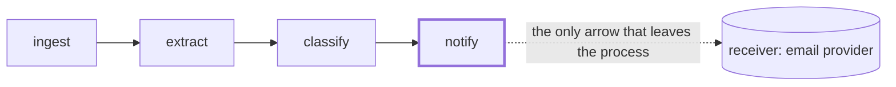
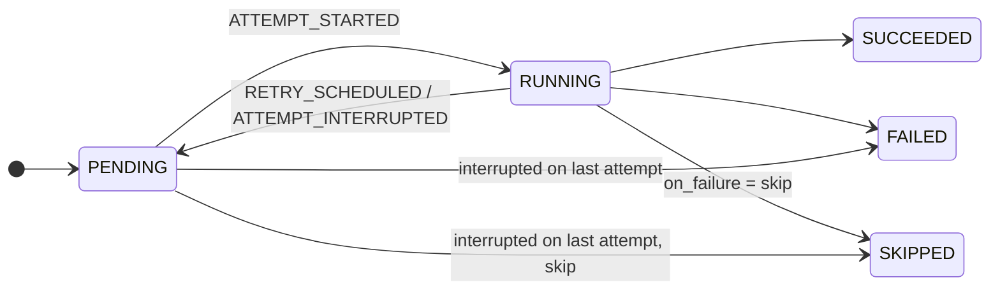
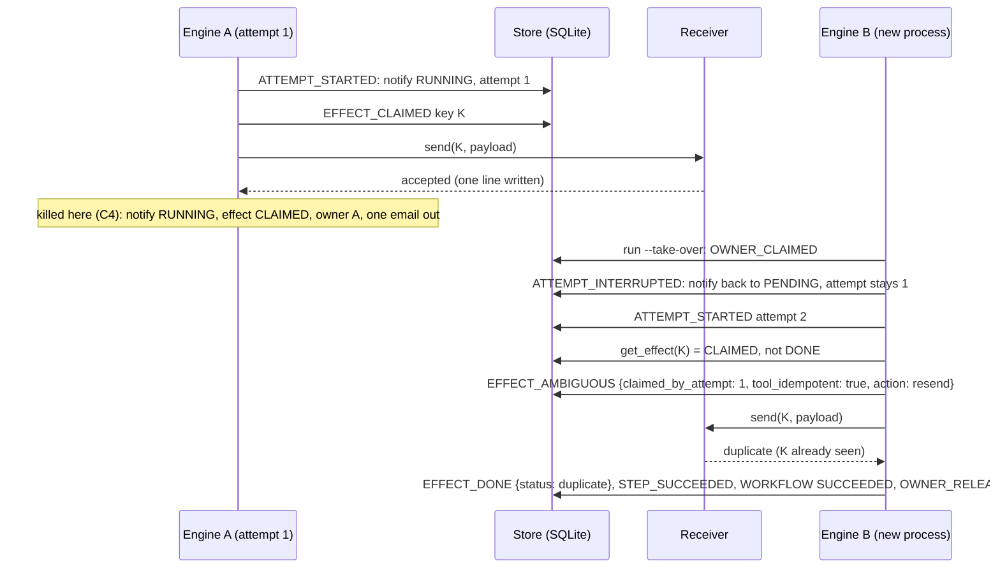
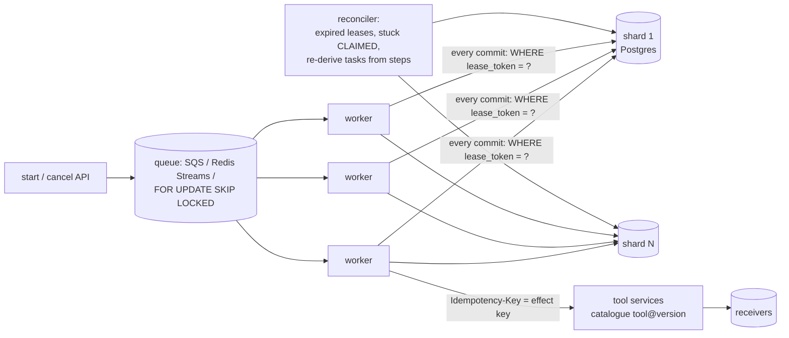

# wfk: a durable workflow kernel (NOT SUBMITTED: presentation deck for the take-home discussion)

Format: one slide per `---`, speaker notes in the `> Notes` block. Twelve slides, 15 minutes of
talk, the rest for questions. Rule for every slide: **a decision, the alternatives, the tradeoff,
and the failure it prevents.** Never a tour of the code. Every number below is read from the code
or the test output; nothing is rounded up.

Numbers to carry: 4 tables, 16 event types, 12 state edges (5 workflow + 7 step), 6 CLI verbs,
7 exit codes, 31 tests in 7 files (~0.1 s), ~1,350 lines of Python incl. docstrings, stdlib only,
16 events and 16 transactions per clean run, backoff 0.05 / 0.1 / 0.2 / 0.4 s capped at 2 s,
key = sha256(workflow:step:effect), demo ~2 s.

---

## 0. Two-minute opening (say it, then go to slide 1)

> "I read the brief as a correctness problem with a short feature list. Four steps, one of them
> with a real side effect, and three things that actually get judged: does a crash at any
> instruction leave state a new process can continue from, is the notification ever sent twice,
> and can an auditor answer 'what happened and why' from what is on disk.
>
> So I spent the first ninety minutes on a design record before writing code: the data model, the
> two state machines, and a table of every crash point in the notify step, C0 to C7, with what is
> on disk at each and what the next process does. The tests fell out of that table.
>
> The model is one sentence: engine decides, store remembers, tool does. Four decisions carry
> it. One: every state change is a single transaction that updates the row and appends the
> events that explain it, fenced on the workflow's owner and on the row's current state, so
> tables and log cannot disagree and a process that lost its claim cannot commit anything. Two:
> side effects go through a ledger keyed by workflow, step and effect name, with no attempt
> number, claimed before the call and marked done after; when the kernel finds a claim with no
> done, it records the ambiguity and lets the tool's declared idempotency decide: resend under
> the same key, or fail the step and leave the row for an operator. Three: the state machine is
> two set literals that the store checks on every write and the replay reducer applies on every
> read, so replay is read-only and doubles as the tamper check. Four: a claim without a TTL,
> because a lease you can steal without a fencing token at commit time is worse than an explicit
> take-over.
>
> The guarantee, stated honestly: at-least-once invocation, exactly-once recording, exactly-once
> effect if and only if the receiver honours the key. The kernel never guesses.
>
> Twenty-seven tests in a tenth of a second, a demo that kills the process after the mail
> provider accepted and shows one notification after resume, and a README that says where each
> cut feature goes. I'd like to walk the four decisions, then the crash timeline, then how this
> becomes a fleet. Stop me anywhere."

> Notes: ~1:55 at a calm pace. If they interrupt, good; follow them. Do not list features.

---

## 1. The problem, read as an engineer

**Ingest → Extract → Classify → Notify**, durable, with a CLI. What is actually being tested:

1. **Correctness under failure**: a crash at any instruction must leave a resumable state.
2. **One side effect, never two**: notify is external; the kernel cannot roll it back.
3. **Auditability**: "what happened" *and* "what was decided, and why", from disk alone.

Everything else (retries, cancel, replay, versioning) is a consequence of getting those right.



> Notes: 45 s. "Three of the four steps are pure functions of their inputs; they can be re-run
> for free. The fourth is the whole problem. I designed around that asymmetry: the kernel treats
> pure steps and effectful steps differently, on purpose, and the tool declares which it is."

---

## 2. Decision 1: one transaction per state change, two fences, tables plus log

```sql
BEGIN IMMEDIATE;                                      -- write lock now: the fence read is what COMMIT is based on
SELECT owner FROM workflows WHERE id = ?;             -- fence 1: still ours?  else LostClaim, ROLLBACK
UPDATE steps SET state=?, attempt=?, ... WHERE workflow_id=? AND name=? AND state=?;  -- fence 2: rowcount must be 1
INSERT INTO events (...) VALUES (...), (...);         -- the events that explain the change
COMMIT;                                               -- synchronous=FULL: on disk before the next action
```

| Alternative | Why not |
|---|---|
| Pure event sourcing (fold on every read) | `status` becomes a fold; every bug in the fold is an incident |
| Tables only, log as best-effort text | audit trail can drift from truth; no tamper check possible |
| Plain `BEGIN` (deferred) | two engines can both read `owner IS NULL` and both proceed |

**Failure it prevents:** a stalled engine that lost its claim committing a stale attempt, a stale
ledger row, or a stale event. Tested in-process: engine A stalls inside the receiver call, an
operator takes over with B, B finishes; every write A then tries is refused and rolled back
(`test_fenced_out_engine_cannot_finish_the_effect`).

> Notes: 90 s. Say the self-review finding plainly: "my first version fenced transitions but not
> the ledger writes; the race test found it; one `_fence` call inside every workflow-scoped
> transaction fixed it." Finding and pinning your own bug is the senior signal, not a weakness.

---

## 3. Decision 2: side effects through a ledger; ambiguity is recorded, not guessed

```
key = sha256(workflow_id : step : effect_name)        -- no attempt number: every retry and restart presents the same key

DONE row     -> return the stored result; the receiver is never called again
CLAIMED row  -> EFFECT_AMBIGUOUS{key, claimed_by_attempt, tool_idempotent, action}
                 tool.idempotent  -> re-call with the SAME key; the receiver dedupes
                 else             -> step FAILED "ambiguous_effect"; row stays CLAIMED for an operator
no row       -> commit CLAIMED -> fn(key, payload) -> commit DONE{result}
```

| Alternative | Why not |
|---|---|
| Transactional outbox + relay | moves the same window into the relay; `status` can say SUCCEEDED while nothing left the building |
| Dedupe-only sink, no kernel bookkeeping | the kernel cannot tell "sent" from "unknown"; no audit of the ambiguity |
| Key includes the attempt number | each retry mints a new key; the receiver cannot dedupe; duplicates by design |

**Failure it prevents:** the duplicate email after a crash between "provider accepted" and
"kernel recorded it". That window cannot be closed by any single-process design; this one makes it
a queryable fact.

> Notes: 90 s. This is the slide they will remember. Say the three shapes you weighed, then: "all
> three have the same unavoidable window; I chose the one that records the window." Then the
> guarantee sentence from slide 5, verbatim.

---

## 4. Decision 3: the state machine is two set literals, used on write and on read



Workflow: `PENDING → RUNNING → SUCCEEDED | FAILED | CANCELLED` (5 edges). Step: 7 edges above.
`WF_ALLOWED` / `STEP_ALLOWED` in `store.py`; `transition_*` refuses any other pair before
writing; `rebuild_state()` applies the same sets to the log.

| Alternative | Why not |
|---|---|
| Free-form status column updates | a bug silently corrupts a row; nothing can prove the log |
| Separate reducer logic for replay | two state machines drift; replay proves nothing |

**Failure it prevents:** silent corruption, and a replay that would "pass" on a corrupted log.
`replay` is **read-only** (never calls a tool), prints the narrative, rebuilds the projection and
diffs it against the tables; a hand-edited row makes it exit 1 (`test_replay_detects_tampered_table`).

> Notes: 60 s. `SKIPPED` is the one addition to the brief's four states: "calling a step that
> never ran SUCCEEDED would lie to the audit log; happy to rename, not to merge." The backward
> edge `RUNNING → PENDING` serves both retry and resume, which is why resume costs almost no code.

---

## 5. Decision 4: a claim, not a lease; and the guarantee, stated exactly

**Claim:** `UPDATE workflows SET owner=? WHERE id=? AND (owner IS NULL OR owner=?)`; rowcount 0 is
`AlreadyOwned`. A dead process leaves a stale owner; the operator clears it with `run --take-over`.

| Alternative | Why not |
|---|---|
| TTL lease, auto-steal | without a fencing token at commit time, a slow tool and the new owner both commit attempt N |
| No claim at all | two CLI invocations on the same id double-execute |

**The guarantee** (verbatim in the README):

> at-least-once **invocation** of an effect; exactly-once **recording** of its outcome;
> exactly-once **effect** iff the receiver honours the idempotency key. When the outcome of a
> non-idempotent effect is unknowable, the kernel records `EFFECT_AMBIGUOUS`, fails the step with
> that reason, and stops. It never guesses and never forks a new execution around it.

> Notes: 60 s. "Exactly-once effect is a property of kernel plus receiver, never of the kernel
> alone. Anyone who claims otherwise has hidden the window in a dispatcher." Then: "the fleet
> version adds the fencing token; that is the one thing this single-process design leaves out on
> purpose, and the first thing I would add."

---

## 6. The crash timeline: killed after the provider accepted, before the kernel recorded it



On disk afterwards: two invocations, **one** notification, one ambiguity event explaining why,
attempt count 2, 20 events, `replay` CONSISTENT. With a receiver that cannot dedupe: step
`FAILED ambiguous_effect`, ledger row stays `CLAIMED`, the workflow still completes because
notify is `on_failure: skip`. Demo §4; `test_notify_effect_once_across_crash`,
`test_ambiguous_non_idempotent_fails_safely`.

> Notes: 90 s. Narrate the disk state at each line; do not read the arrows. C3 (killed during
> the HTTP call) is indistinguishable from C4 on disk, which is exactly why the decision is
> delegated to the tool's declared idempotency rather than to a guess. C5 (DONE committed, step
> not yet SUCCEEDED) returns the stored result without calling the receiver
> (`test_done_effect_is_not_resent_on_resume`).

---

## 7. Demo (pre-run; show the terminal, not the code)

```bash
scripts/demo.sh            # temp dir, ~2 s, Python 3.9 or 3.14, stdlib only
```

1. Clean run: four `SUCCEEDED`, effect `DONE`.
2. `--fail extract:2`: two `RETRY_SCHEDULED` (0.05 s, 0.1 s), success on attempt 3, ingest untouched.
3. `--crash-after classify` (`os._exit`): plain `run` refused, exit 3 (dead claim); `run --take-over`
   finishes; ingest/extract/classify not re-run; one notification.
4. `--crash-in-notify`: `status` shows notify `RUNNING`, effect `CLAIMED`, one line already in the
   receiver; resume → `EFFECT_AMBIGUOUS … -> resend`; still one line.
5. `history --kind DECISION` → why it is an invoice (keywords, confidence 0.95); `replay` → CONSISTENT.
6. `cancel`; operator errors are messages with exit codes, never tracebacks.

> Notes: 60 s with a captured run. Highlight exactly two lines: the `CLAIMED` status row before
> the resume, and `EFFECT_AMBIGUOUS … -> resend` after. Those two lines are the whole take-home.

---

## 8. Evolution: 10k+ concurrent workflows, multiple services



| Concern | Now | Then |
|---|---|---|
| State ownership | one SQLite file | shard by `hash(workflow_id)`; the shard's `events` is the authority; same schema; `events` partitioned by month |
| Execution | in-process loop | stateless workers pull "run step X of W, attempt N"; one runnable task per workflow keeps order |
| Claim | `owner`, `--take-over` | lease `(owner, lease_until, lease_token)`, heartbeat, **token checked on every commit** |
| Tools | in-process registry | services behind RPC; key sent as `Idempotency-Key`; timeouts → Retryable, 4xx → Fatal |
| Failure boundaries | process | worker dies → lease expires → redelivery → `ATTEMPT_INTERRUPTED`, fenced; receiver dies → ambiguity, visible; queue lost → tasks re-derived from `steps` (queue is an accelerator, never truth); one shard down → that shard pauses |

Sizing: 10k concurrent ≈ a few hundred transitions/s, ~50 events per workflow; one Postgres is
comfortable; archival is a retention decision, not capacity.

> Notes: 90 s. One sentence first: "the claim becomes a lease with a fencing token; everything
> else is a deployment choice." If asked about Temporal/Conductor: same model (log is truth,
> workers are stateless, effects are keyed); the brief asked for the kernel, and I wrote where
> the other 99% goes. Cisco telemetry platform only if asked how you know the Postgres sizing:
> partitioned append-only tables at 50+ PB per year, far above this.

---

## 9. Versioning: evolving tools and workflows without breaking what is in flight

- **Pin**: `workflows.spec_version` is set at `start` and never changes; `SPECS[(name, version)]`
  holds every published version; `Engine.start` refuses to re-register a key with a different body.
- **Immutable published versions**: add/remove/reorder a step, or change `max_attempts` /
  `on_failure` → new spec version. Tool contract change → `tool@2` in the registry; outputs are
  additive; a reshape gets a reader-side adapter, never a rewrite of stored `output_json` or events.
- **Drain**: retire a version only when no `PENDING`/`RUNNING` workflow references it (one SQL
  count). Migrating an in-flight workflow is an explicit, logged `MIGRATED{from,to}` event.
- **Why nothing breaks**: the engine is a function of (database, registry); deploying a registry
  that still contains the old versions changes only what `start` creates.

**Failure it prevents:** a deploy that changes step order under a workflow that is halfway through,
or a tool whose new output shape breaks the step after it.

> Notes: 45 s. If asked "what if a tool is removed?": "the engine refuses to run a workflow whose
> spec names a tool not in the registry, before it claims it; the failure is a message with exit
> 5, not a half-started run."

---

## 10. Multi-tenancy, compliance, operability

**Tenancy:** `tenant_id` on every table and as the first component of the effect key
(`sha256(tenant:workflow:step:name)`) so client-supplied workflow ids can never collide across
tenants; a `Store(tenant)` wrapper adds the predicate to every query; per-tenant concurrency and
rate limits in the scheduler; separate shard for regulated tenants.

**Audit and compliance:** `events` is append-only by construction (no UPDATE/DELETE path exists in
`store.py`; a trigger enforces it in Postgres); `replay` is the tamper check; redaction hook before
`append_event`; retention that tombstones `payload_json` and keeps the skeleton; `prev_hash`
chaining when a regulator requires it.

**Operability as built:** `status` is one SELECT per table; `history --kind` is a query not a grep;
seven exit codes; operator errors are one-line messages; a stuck `CLAIMED` row is visible in
`status`. **Next:** metrics (attempts, retries, ambiguities, time in state), a reconciler that lists
stuck claims and expired leases, SLOs on time-to-terminal and ambiguity rate (target: zero
unresolved `CLAIMED` rows older than the lease).

> Notes: 60 s. Keep it concrete: "the ambiguity rate is the SLO I would alert on; every one is
> either a receiver that does not honour keys or a crash in the window, and both are actionable."

---

## 11. What I deliberately did not build, and why

| Not built | Why, and where it goes |
|---|---|
| TTL lease and stealing | unsafe without a fencing token; the fleet design adds both together |
| Transactional outbox + relay | moves the window, does not close it; would let `status` lie |
| `NotSent` signal from the receiver | would let a non-idempotent tool retry a "connection refused" safely; today that case fails as ambiguous (the honest at-most-once stance); first follow-up |
| Preemptive cancel | unsafe mid-effect; cooperative flag between attempts; `ctx.check_cancel()` later |
| DAG / parallel steps, YAML, `tenant_id`, hash chain, metrics, `run --follow`, `effects resolve`, `start --derived-from` | each is a sentence in the README with its place; none earns 20 lines in a 4-6 hour codebase |
| Verifying a tool's `idempotent` claim | declared, not enforced; becomes enforceable at the RPC boundary with `Idempotency-Key` |

> Notes: 45 s. Volunteer the `idempotent`-is-declared row before they find it; naming your
> weakest point first is the most principal-level move in the room.

---

## 12. Week 1 at Trase, and the close

If this kernel were the seed of the execution model at Trase:

1. **Days 1-2:** read the current engine's write paths and list every place state changes without an
   event, and every external call without a key; that list is the backlog.
2. **Days 2-3:** lease + fencing token on the claim path, with the in-process race test ported first.
3. **Days 3-4:** effect ledger at the activity boundary; receivers classified idempotent / not;
   ambiguity rate on a dashboard.
4. **Day 5:** replay-as-consistency-check running against production shadows; versioning rule
   written down and enforced in CI (published spec versions are immutable).

**30-second close:**

> "Four decisions: one transaction per change with two fences; a ledger that records ambiguity
> instead of guessing; one state machine used on write and on read; an explicit claim over an
> unsafe lease. The honest guarantee is at-least-once invocation, exactly-once recording,
> exactly-once effect when the receiver honours the key. Everything cut has a named place. I'd
> rather spend the remaining time on whichever of these you want to pull on."

> Notes: stop talking after the close. Do not summarize again; do not apologize for anything cut.
